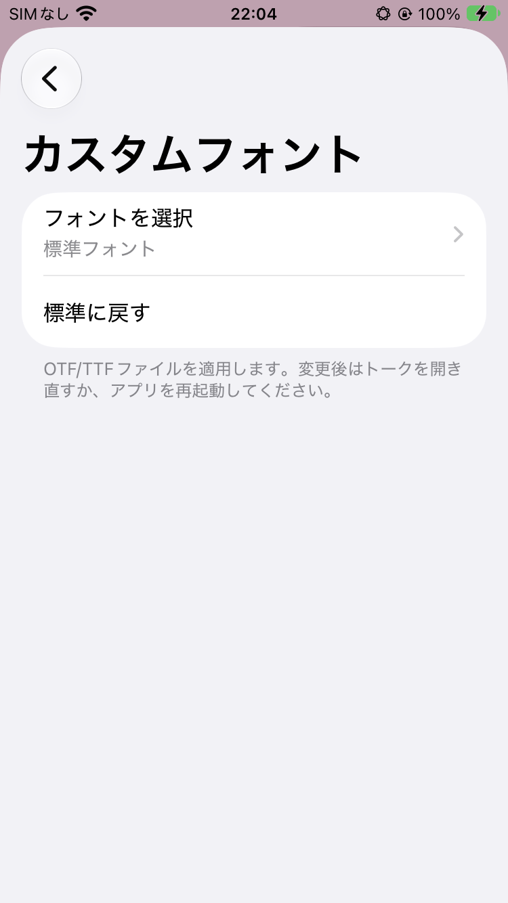
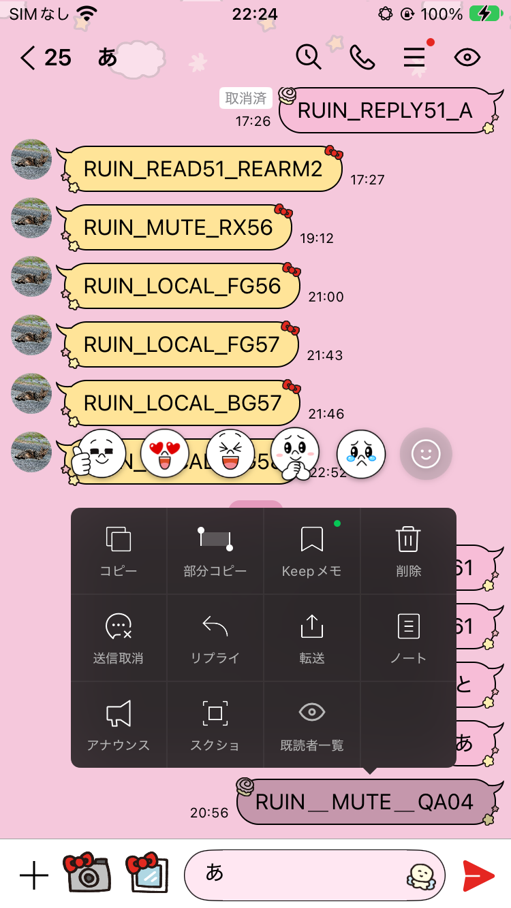
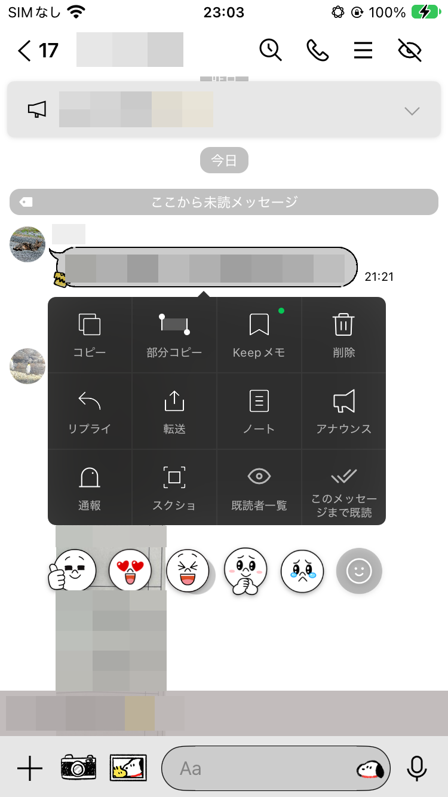
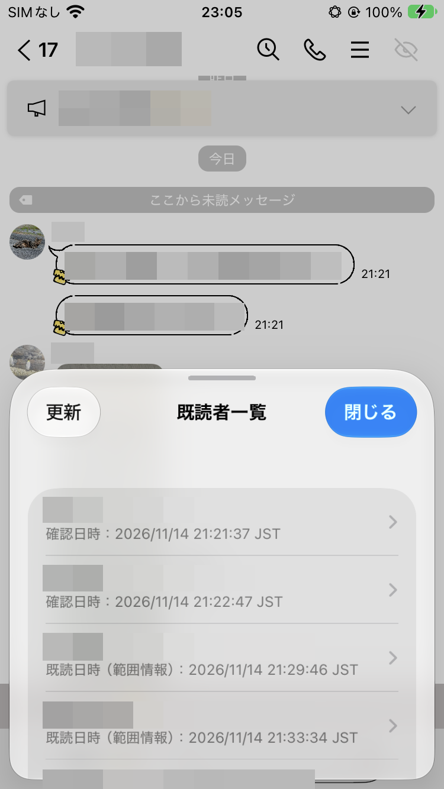
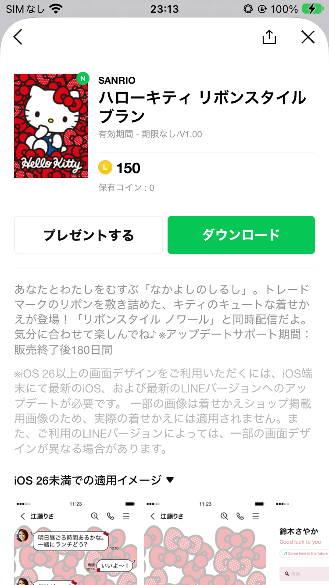
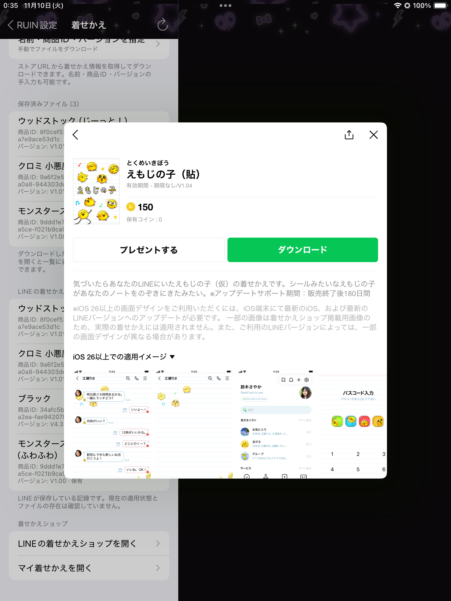

# RUIN

iOS 版 LINE 向けの非公式機能拡張（Tweak）です。  
既読回避、送信取消メッセージの保持、ミュート送信、タブや表示のカスタマイズ、着せかえ・カスタムフォント適用などの機能を提供します。

> [!NOTE]
> 本プロジェクトは非公式の拡張機能であり、LINEヤフー株式会社およびその関連会社とは一切関係がありません。利用は自己責任でお願いします。

---

## 対応環境

| 項目 | 内容 |
| :--- | :--- |
| **対応 LINE バージョン** | **26.17.0**（Build `2026.1103.1841`）のみ |
| **対応 OS** | iOS 18.0 以降 |
| **アーキテクチャ** | `arm64` / `arm64e` |
| **利用可能な環境** | **LiveContainer** / **Sideload**（無料 Apple ID・有料購入証明書の両方に対応） / **Jailbreak**（Rootless・Rootful） |

### テスト済み実機

以下の実機環境で動作テストを行っています。

- **iPhone SE（第2世代）** — iOS 27 / LiveContainer / 有料証明書署名（ESign, GBox）
- **iPad（第8世代）** — iOS 18.2.1 / Dopamine（Rootless Jailbreak）

---

## スクリーンショット

| ホーム画面 | LINE 設定内の入口 | RUIN 設定 |
| :---: | :---: | :---: |
|  |  |  |

| カスタムフォント | メッセージ長押しメニュー | ミュート送信 |
| :---: | :---: | :---: |
|  |  |  |

| このメッセージまで既読 | 既読者一覧 |
| :---: | :---: |
|  |  |
| 長押しメニューから「このメッセージまで既読」を選択 | **自分以外が送信したメッセージ**でも、既読者と既読日時を確認できます。 |

| テーマ詳細 | iPadでのテーマ商品詳細 |
| :---: | :---: |
|  |  |
| テーマストアの商品詳細ページ | iPadで表示したテーマ商品詳細 |

---

## 機能一覧

### メッセージ・既読管理
- **既読を隠す**: トークを開いても既読をつけません。トーク一覧から個別の例外設定ができるほか、トーク画面ヘッダーのアイコンからも切り替えられます。
- **返信時に既読**: 自分が返信を送信したときだけ既読をつけます。
- **このメッセージまで既読**: メッセージ長押しメニューから、選択したメッセージまでを手動で既読にします（後続のメッセージは未読のまま保持）。
- **既読者一覧**: メッセージ長押しメニューの「既読者一覧」から、既読をつけたメンバーと日時を確認できます。
- **送信取消の保持**: 相手が送信取消したメッセージ本文・受信済みメディアを端末内に保持し、「取消済」マーク付きで表示・プレビューできます。
- **24時間以内の送信取消**: 送信後 24 時間以内のメッセージ取消に対応します。
- **ミュート送信**: 送信ボタンを約 2 秒長押しするとメニューが開き、相手に通知を送らずに送信できます。
- **スタンプを GIF でコピー**: メッセージ長押しメニューからスタンプを GIF 画像としてコピーできます。

### 表示・ナビゲーション・誤操作防止
- **不要要素の非表示**: 広告、おすすめ欄、音声入力ボタン、Agent-i バーを個別に非表示化できます。
- **タブ管理**: ショッピング、VOOM、ウォレット、ニュース・通話、設定、アプリなどのタブを非表示にできます。起動時に開くタブの固定にも対応しています（変更は再起動後に反映）。
- **ローカル表示名変更**: トーク画面や設定から、この端末内だけの表示名に変更できます（相手には反映されず、いつでも元に戻せます）。
- **操作確認アラート**: グループ送信前（最低人数指定可）、通話開始前、カメラオン前、通話終了前に確認ダイアログを表示できます。

### テーマ・カスタムフォント
- **着せかえ機能**: ストア URL や商品 ID・バージョン指定での着せかえダウンロード、プレビュー、マイ着せかえへの追加が行えます。公式ショップ・スタンプショップへの導線も備えています。
- **カスタムフォント**: 32MB 以下の `.otf` / `.ttf` ファイルを読み込み、LINE 上のフォントを変更できます（いつでも標準に戻せます）。
- **ローカル LYP 機能**: アプリアイコン変更などのローカル UI 機能を有効化できます。

### その他
- **ユーザー検索・MID コピー**: MID を指定してプロフィールを開いたり、トーク画面ヘッダー長押しから MID をコピーしたりできます。
- **サブ端末ログイン切替**: ログアウト後、ログイン画面の「ログイン」を長押しすることで「通常の iPhone」と「iPad 扱いのサブ端末」モードを切り替えられます。
- **年齢確認のスキップ**: 年齢確認ダイアログをスキップします。
- **新着メッセージのローカル通知**: アプリ起動中の 1対1・グループトークの新着メッセージをローカル通知で知らせます（※アプリ停止中のプッシュ通知には対応していません）。
- **多言語対応**: 日本語・英語・韓国語・簡体字中国語・繁体字中国語の 5 言語に対応しています。

---

## 導入方法

### 設定画面の開き方
LINE の **「設定」タブ最下部** に追加される **「RUIN」** から開けます（iPad やサブ端末モード時は、ホーム画面右上の歯車アイコンからも開けます）。

### Jailbreak 環境（Rootless / Rootful）
リリースページにある環境別の `.deb` パッケージをインストールし、LINE を再起動してください。
- **Rootless**（Dopamine など）: `RUIN-<version>-rootless.deb`
- **Rootful**: `RUIN-<version>-rootful.deb`

> [!NOTE]
> Cydia Substrate や libhooker などの外部フックライブラリへの動的リンクは不要で、各環境の注入ローダーからそのまま読み込めます。

### LiveContainer（単体 dylib）
1. リリースページから `RUIN-<version>-LiveContainer.dylib` をダウンロードし、未改変（RUIN 未注入）の LINE iOS **26.17.0** 復号済み IPA を用意します（RUIN 注入済み IPA には二重注入しないでください）。
   - 5言語の翻訳・設定情報・アイコンがバイナリ内に同梱されているため、外部の `RUINResources.bundle` は不要です（従来の外部バンドル併用も引き続き対応しています）。
2. LiveContainer に LINE を導入し、標準の TweakLoader（Tweak 管理機能）から `RUIN-<version>-LiveContainer.dylib` を選択して LINE 向けに有効化します。

### Sideload（IPA 注入・非脱獄）
1. 未改変（RUIN 未注入）の LINE iOS **26.17.0** 復号済み IPA と、リリースページの `RUIN-<version>-jailed.deb` を用意します（RUIN 注入済み IPA には二重注入しないでください）。
   - `jailed.deb` 内では `/Library/MobileSubstrate/DynamicLibraries/` 配下に `RUIN.dylib` と `RUINResources.bundle` が格納されています。
2. **ESign** / **GBox** などの署名ツール、または既存の `package.py` による個人署名フローで `RUIN.dylib` と `RUINResources.bundle` の両方をアプリへ注入・署名してインストールします。
   - 無料の Apple ID でも有料の購入証明書でも利用できます。

> [!TIP]
> 既存のトーク履歴やログイン状態を保持してアップデートする場合は、これまでと同じ Bundle ID と署名環境を引き継いでください。

---

## ビルド方法

### 必要な環境
- macOS / Xcode（iOS SDK を含む）
- `make`, `perl`, `python3`（ホストテストも実行する場合は `node`）

### コマンド

```bash
# Universal dylib (arm64 + arm64e) とツールをビルド -> build/RUIN.dylib
make -j4 all

# 配布用パッケージ (.deb 3種・LC用dylib・SHA256SUMS) を生成 -> dist/
make dist

# ホストテストの実行（任意）
make -j4 check-host
```

ビルド成果物は以下に生成されます。
- **バイナリ**: `build/RUIN.dylib`（手動注入時は `resources/RUINResources.bundle` も同梱してください）
- **配布パッケージ**: `dist/RUIN-<version>-{rootless,rootful,jailed}.deb`、`dist/RUIN-<version>-LiveContainer.dylib`、`dist/SHA256SUMS`

### 署名済み IPA の生成（開発者向け）
手元の `.ipa`・証明書（`.p12`）・プロファイル（`.mobileprovision`）を使って署名済み IPA を直接ビルドするスクリプトも同梱しています。

```bash
python3 tools/package.py \
  --ipa <LINE.ipa> \
  --profile <profile.mobileprovision> \
  --p12 <certificate.p12> \
  --password-file <password.txt> \
  --udid <device-udid>
```
