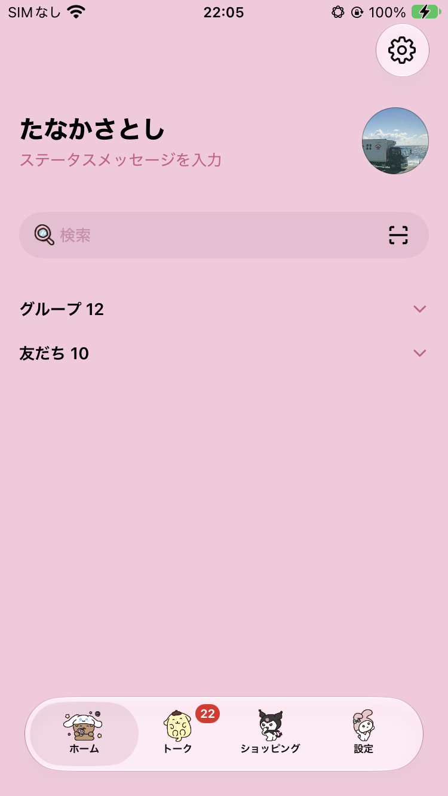
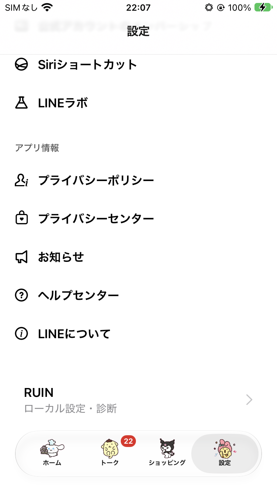
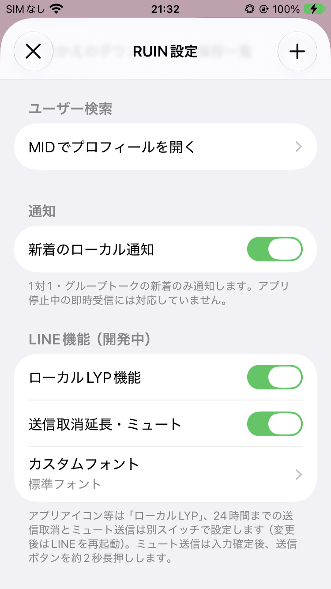
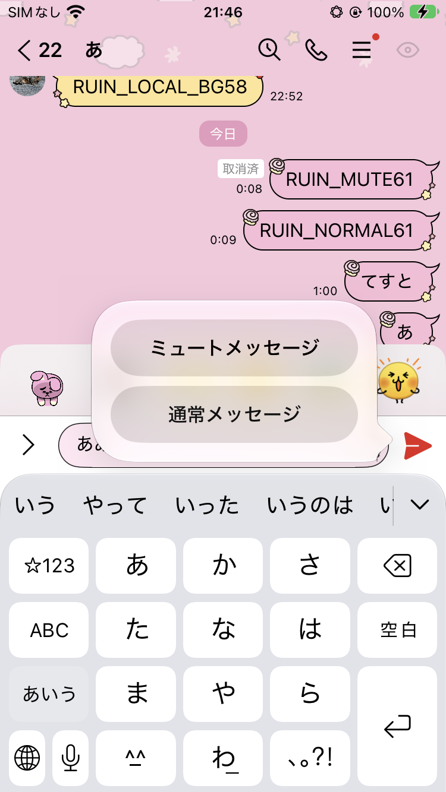

# RUIN - iOS LINE Extension

RUINは、iOS版LINE向けの非公式機能拡張パッケージです。公式アプリのネイティブUIおよび内部構造を尊重しつつ、メッセージング制御、プライバシー保護、ローカルカスタマイズ機能を提供します。

※本プロジェクトは非公式の拡張機能であり、LINEヤフー株式会社およびその関連会社とは一切関係がありません。本ドキュメントは合意されたアーキテクチャ仕様に基づいてGemini 3.8 Flash Highにより執筆・レビューされています。

---

## スクリーンショット

代表的な画面例です（新機能の追加時も、プライバシー検査を経て同様に画像を追加できます）。

| ホーム画面 (友だち/グループ両折りたたみ) | LINE設定内のRUIN入口 |
| :---: | :---: |
|  |  |

| RUIN詳細設定 | ローカルカスタムフォント管理 |
| :---: | :---: |
|  |  |

| メッセージ長押しメニュー | ミュート送信 |
| :---: | :---: |
|  |  |

※掲載スクリーンショットは、作業担当者が公開前にプライバシー検査（目視確認）を実施した実機キャプチャです。
※ホーム画面画像はプライバシー保護のため、友だちリストおよびグループリストを両方折りたたんだ状態で撮影しています。
※実機にて正常動作を確認した画面（ミュート送信画面 `mute-send.png` 等）は、目視によるプライバシー検査を経て掲載可能です。
※プライバシー保護のため、ログイン中のアカウント本人を除く相手の表示名・プロフィール画像（サブアカウント含む）にモザイク処理を施し、ホーム画面の友だち・グループリストを折りたたんで掲載しています。

---

## 動作要件・対象環境

### 実行時環境 (Runtime)
- **対象LINEバージョン**: 26.16.0 (Build: `2026.1006.1718`)
- **アーキテクチャ**: `arm64`
- **下限OS**: iOS 18.0 以降 (※ビルド下限値であり、全機種・全環境での動作を保証するものではありません)
- **ランタイム依存**: 外部の Cydia Substrate / libhooker や Python/pip 依存は不要です。Apple/system Swift ランタイム、iOS標準システムフレームワーク、および同梱の `RUINResources.bundle` のみで動作します。
- **互換性保護**: 対象バージョン以外の動作は保証しません。バイナリUUID、内部型定義、関数ABI等の不一致を検知した場合は、クラッシュやデータ破壊を防ぐため、該当フックを安全に自動無効化（フェイルセーフ）します。

### ビルド環境 (Build Environment)
- **ホストOS**: macOS (GitHub Actions macOS ランナー対応)
- **必要ツールチェーン**:
  - フル Xcode (iOS SDK 含む)
  - `make`
  - `Perl` (内蔵 Logos generator 処理用)
  - `Python 3` (パッケージング・署名準備ツール用)
  - `Node.js` (ホスト環境検査および構文検査用)

---

## 主な機能

### ネイティブUI統合
LINE本来の標準UI構造および `TabView` をそのまま使用します。サードパーティ製の独自タブバーへの置き換えは行いません。

### メッセージング & プライバシー
- **既読非表示**: 既読を付けずにトークメッセージを閲覧できます。
- **トーク個別切り替え**: トーク画面ヘッダーのTablerアイコン (`eye` / `eye-off`) から、トークごとに既読動作を切り替えられます。
- **返信時自動既読**: メッセージを送信・返信した際に自動的に既読を送信します (※特定状況下での挙動は検証中)。
- **既読者一覧シート**: メッセージ長押しメニューのTabler `eye` アイコンから、既読者の表示名と日時を確認できます。取得できた既読範囲を表示し、未観測の正確な日時や常に完全な一覧の提供を保証するものではありません。「確認日時」と「実イベント由来日時」を厳密に区別し、後日取得した時刻によって過去の記録済み日時が上書きされることはありません。
- **送信取消メッセージの端末内保持**: 相手が取り消したメッセージ本文を端末内に保持し、「取消済」マークを付与して表示します。
- **送信取消延長・ミュート送信 (独立設定)**:
  - **24時間までの送信取消**: 送信後24時間以内のメッセージについて、端末側での送信取消を可能にします（対応範囲は24時間まで）。
  - **ミュートメッセージ送信**: 本文入力確定後、送信ボタンを約2秒長押しすることでLINEネイティブの選択メニュー（ミュート／通常）が表示され、相手に通知を送らずにメッセージを送信できます。
  - ※本機能は、アプリアイコン等のローカルLYPとは独立した専用スイッチ『送信取消延長・ミュート』でON/OFFを切り替えます（設定反映にはLINEの再起動が必要です）。
- **ローカル表示名**: 端末上でのみ友だちの表示名を上書き変更します (相手側やサーバー側には反映されません)。

### 表示管理 & ナビゲーション
- **表示要素の管理**: 広告、おすすめコンテンツ、音声入力UI、Agent-i の表示/非表示を個別に制御できます。
- **タブ管理**: 不要なネイティブタブを非表示にし、起動時に表示する初期タブを指定できます (ホーム・トーク等の必須タブは非表示にできません)。

### テーマ & カスタムフォント
- RUIN設定の「ショップ」から公式ネイティブ画面を開き、スタンプの商品詳細や画像プレビューの閲覧に対応（※購入・プレゼント・権利付与は未検証）
- **ネイティブ着せかえ**: 公式着せかえショップやマイ着せかえのローカル適用・再取得、ストアURLからのメタデータ取得に対応します (※サーバー側の購入権限を付与するものではありません)。
- **ローカルカスタムフォント**:
  - 「RUIN設定」→「カスタムフォント」から、32MB以下の単一OTF/TTFファイルをiOS標準ファイル選択 (UIDocumentPicker) 経由でインポートできます。
  - アプリのプライベート領域へ安全に保存され、アプリ再起動後も保持されます。標準フォントへの復帰機能も備えています。
  - 破損ファイルの拒否、同一フォントの再選択、標準復帰の動作は実トークにて検証済みです。
  - 本機能は端末内完結の独自機能であり、LYPプレミアム契約とは完全に独立しています。
  - ※フォント変更の反映には、トーク画面を開き直すかアプリの再起動が必要です。

### 多言語ローカライズ
- 日本語 (`ja`)、英語 (`en`)、韓国語 (`ko`)、簡体字中国語 (`zh-Hans`)、繁体字中国語 (`zh-Hant`) の5言語に対応。
- システムおよびアプリの優先言語に連動し、未対応言語や欠落キーは自動的に英語へフォールバックします。
- UIリソースは `resources/RUINResources.bundle/<locale>.lproj/Localizable.strings` (XML Property List形式) で管理され、コード内からは `RUINLocalizedString` 関数/ヘルパーを経由して取得されます。LINEネイティブ文字列との照合にはLINEバンドル内の公式ローカライズキーを使用します。

---

## 実験的・制限事項のある機能 (β)

以下の機能は仕様上の制限等があるため、注意点とともに提供されています。

- **ローカルLYP表示 (実験的)**:
  - ネイティブアプリアイコン選択などのローカルUI表示機能です。実際の契約状態やサーバー権限は一切改変しません（送信取消延長・ミュート送信とは独立した別スイッチとして提供されます）。
- **新着ローカル通知 (制限事項)**:
  - 新着メッセージをローカル通知として表示する機能を備えていますが、脱獄を行わないJailed環境の制約上、アプリ停止状態での即時受信やAPNs本来のバックグラウンド配送機能は提供されません。
- **通話録音 (未確認)**:
  - LINEラボに存在するネイティブ録音機能のフラグ有効化までを実装していますが、実通話環境での録音試験は未実施のため、動作完了扱いにはしていません。

---

## アーキテクチャと依存関係

- **フック実装**: Logos (`.x`, `%hook`, `%orig`, `%new(typeencoding)`, `%group`, `%init`) およびリポジトリ内蔵の internal generator を使用。外部の Cydia Substrate や libhooker は不要です。`MSHookIvar` などの外部依存関数を追加せず、内部完結の実装を維持します。
- **シンボル解決**: C関数の既存import rebindにはfishhookを使用し、Swiftの一部の検証済みwitness/data-pointerアダプターは型検証・ABI検証を実施して保持しています。
- **データ破壊防止とバージョンゲート**: トーク履歴データベース、アカウント設定、キーチェーン等の破壊・破損を防止するため、バイナリUUID、内部型定義、関数ABI、クラス構造の厳格なバージョンゲートを備えています。
- **バイナリパッチ方針**: アプリバイナリ内のMach-O命令コードや定数テーブルへの直接バイナリパッチは行いません。署名用 `LC_LOAD_DYLIB` の追加と署名メタデータのみを使用し、元バイナリの全既存セクションとロードコマンドの整合性を保持します。汎用注入ツールへの無条件の全対応は保証せず、既存のバージョンゲートと適切な署名メタデータが必要です。
- **動的リンク**: `otool` による検査の結果、動的リンクはiOS標準frameworkおよびSwift/システムライブラリのみに限定されています。
- **必須リソース**: Tablerアイコンおよび5言語のXML Property List翻訳リソースを含む `RUINResources.bundle` が必須です。dylib単体ではUIアセットが欠落し正常に描画されません。

---

## ビルドとパッケージング

### ビルドコマンド

```bash
# ビルド成果物の生成
make -j4 all

# ホスト環境検査
make -j4 check-host

# パッケージング検査・ポータブル整合性検査
make check-packaging
make check-portable

# バージョン確認
make version

# 配布パッケージの生成
make dist

# バージョンを手動指定してビルドする場合
make RUIN_BUILD_VERSION=0.4.0 all
make RUIN_BUILD_VERSION=0.4.0 dist
```

※実バイナリや着せかえアーカイブを用いた検証には `make check-fixtures` を使用します (テスト用フィクスチャが必要)。
※製品バージョンはリポジトリの `VERSION` ファイルを基準とします。生成物は `build/` および `dist/` に出力され、Git追跡対象外です。

### 配布パッケージ構成

推奨配布形式は同梱Jailed DEBまたは手動注入用ZIPです。
- `<package-name>_<version>_iphoneos-arm64.deb`
- `RUIN-<version>-manual-injection.zip`
- `RUIN-<version>-ios-arm64.dylib`

パッケージ内の配置構造:
```text
Library/MobileSubstrate/DynamicLibraries/
├── RUIN.dylib
├── RUINResources.bundle
└── RUIN.plist (Filter XML)

usr/share/doc/com.tqmane.ruin/
└── RUIN-ThirdPartyNotices.txt
```

※ライセンス表記は `usr/share/doc/com.tqmane.ruin/RUIN-ThirdPartyNotices.txt` に配置されます（dylibの隣のNOTICEではありません）。提供されるDEBはJailed環境への注入を主用途としたpayloadであり、脱獄端末でのdpkg直接インストールを前提とするものではありません。また、あらゆる汎用注入ツールや署名ツールでの動作を保証するものではありません。

---

## 署名とインストール

署名および端末へのインストールには、ユーザー自身が用意した復号済みIPA、Apple Developer証明書、および対象端末のUDIDが登録されたプロファイルが必要です。リポジトリに機密情報やIPAは含まれていません。

リポジトリ同梱の `tools/package.py` は、`Info.plist`、`App Group`、キーチェーン共有等の署名準備処理を実行します。

### 署名コマンド実行例 (プレースホルダー)

```bash
python3 tools/package.py \
  --ipa <LINE.ipa> \
  --profile <profile.mobileprovision> \
  --p12 <certificate.p12> \
  --password-file <password.txt> \
  --udid <device-udid> \
  --bundle-id <profile-allowed-bundle-id> \
  --dylib <RUIN.dylib> \
  --resources <RUINResources.bundle>
```

※インストール済みの既存LINEトーク履歴やログインデータを維持する場合は、既存のBundle ID、App Group、およびキーチェーン共有設定を変更しないでください。

---

## CI / CD

- **Validate RUIN**:
  - トリガー: Pull Request / `main` ブランチへのpush / 手動実行 (`workflow_dispatch`)
  - 内容: Linux環境でのポータブル検査、macOS環境でのビルド・テストを実行（Node.js構文検査含む）。
- **Build RUIN distribution**:
  - トリガー: 手動実行 (`workflow_dispatch`) / `v*` タグのpush
  - 内容: SemVer規則を検証し、タグpush時はプレフィックス `v` を除いた文字列をバージョンとして採用。macOS上でビルド、ホスト検査、パッケージ検査、外部依存検査を実施。
  - 成果物:
    - `RUIN-<version>-ios-arm64.dylib`
    - 配布用DEBパッケージ
    - `RUIN-<version>-manual-injection.zip`
    - `RUIN-ThirdPartyNotices.txt`：同梱・利用しているサードパーティ製ソフトウェアのライセンス表記
    - `SHA256SUMS`
  - タグpush時はGitHub Releaseへ自動添付され、手動実行時はGitHub ActionsのArtifactsに保存されます。

※公開CIには秘密情報や復号済みIPAは一切含まれず、使用もされません。
